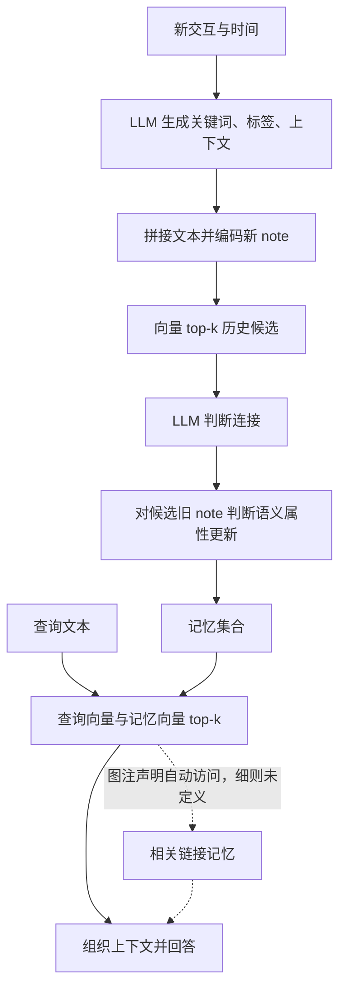

# A-MEM：让新经验改变历史记忆的组织方式

> 论文：*A-Mem: Agentic Memory for LLM Agents*，Wujiang Xu、Zujie Liang、Kai Mei、Hang Gao、Juntao Tan、Yongfeng Zhang。
> 版本：[`arXiv:2502.12110v11`](https://arxiv.org/abs/2502.12110v11)，2025-10-08；研究更新：2026-10-30。
> 范围：论文的问题、方法、实验与限制；未复现模型实验，未核查开源项目全部实现。方法事实与报告数字以固定版本为准，教学推演和研究判断另作说明。

## 1. 它希望解决什么问题

设想一个长期交流的助手：它保存过“用户在阳台种薄荷”，后来又收到“用户开始带邻居做香草种植活动”。单纯把两段文本分别存下，查询时按语义相似度找回，可以保留事实，却不会主动重新理解前一条经验在更大活动中的位置。A-MEM 要研究的是：**新经验到来时，能否同时改善新记忆的表示、发现它与旧记忆的联系，并让旧记忆的上下文解释随之变化？**

作者将既有系统的固定结构与预设操作视为限制，借鉴 Zettelkasten（卡片盒笔记法）的三个想法：一条笔记承载相对独立的知识；笔记通过联系形成网络；分类可以随知识增长而发展。A-MEM 将这些想法转化为由 LLM 生成语义属性、选择链接、更新历史笔记的外部记忆系统。[§1–§3](https://arxiv.org/html/2502.12110v11#S1)

这里的研究贡献主要落在写入与组织阶段。普通向量检索也可使用丰富的 metadata；A-MEM 更进一步把新记忆引起的历史表示调整作为明确步骤。作者用长期对话问答实验检验这套组合是否有用，论文没有给出普适正确性的理论证明。

“Agentic”在这里指 LLM 在既定流程中作语义决策：生成怎样的描述、连接哪些候选、怎样演化旧笔记。系统仍预设字段、近邻筛选、提示词与处理阶段。不能由此理解为已经具备自主发明记忆算法、任意决定读写时机或迭代规划查询的控制器。记忆发生变化的是外部文本属性与关系，论文也没有把这一过程定义为更新基础模型权重。[§2.2](https://arxiv.org/html/2502.12110v11#S2.SS2)

## 2. 一条记忆由什么组成

论文 §3.1 定义记忆集合 $\mathcal M$，其中每条 note 为：

$$
m_i=\{c_i,t_i,K_i,G_i,X_i,e_i,L_i\}.
$$

| 字段 | 含义 | 在上述例子中的可能内容 |
|---|---|---|
| $c_i$ | 原始交互内容 | “我在阳台种薄荷” |
| $t_i$ | 交互时间戳 | 收到这次交互的时间 |
| $K_i$ | LLM 生成的关键词，突出具体概念 | 薄荷、阳台、种植 |
| $G_i$ | LLM 生成的分类标签 | 园艺、日常活动、植物 |
| $X_i$ | LLM 生成的上下文描述 | 用户介绍自己在阳台种植香草的活动 |
| $e_i$ | 文本编码器产生的向量 | 用于相似度计算 |
| $L_i$ | 相关记忆的链接集合 | 指向另一些历史 note |

后三列文本是人为构造的教学示意，不是论文实测输出。关键词用于突出具体信息，标签用于较宽的归类，上下文描述则补出“这条交互在讲什么”；三者都可能受 LLM 的理解影响，不能与原始内容的直接事实地位等同。

构造分两步。先让 LLM 阅读交互与时间，生成语义属性：

$$
K_i,G_i,X_i\leftarrow \operatorname{LLM}(c_i\|t_i\|P_{s1}).
$$

再把原始内容和这些属性拼接后编码：

$$
e_i=f_{\mathrm{enc}}\bigl[\operatorname{concat}(c_i,K_i,G_i,X_i)\bigr].
$$

因此向量承载的不只是原话，也包含模型生成的解释。论文实验使用 `all-minilm-l6-v2` 编码器。独立的 $t_i$ 与 $L_i$ 没有直接写入这条编码公式；但日期若已出现在原话或生成描述中，仍可能经文本进入向量，不能说向量绝不含时间信息。[§3.1，式 (1)–(3)](https://arxiv.org/html/2502.12110v11#S3.SS1)、[§4.2](https://arxiv.org/html/2502.12110v11#S4.SS2)

附录 B.1 要求结构化输出 keywords、context、tags；keywords 至少三个，且不要把说话人姓名或时间当关键词。正文强调每条 note 是自包含的知识单元，但没有给出将一段含多事实的交互自动拆为多个原子 note 的完整算法。“原子性”是设计原则，不能因此假定任意长交互已经得到可靠拆分。

## 3. 新记忆怎样改变历史记忆

### 3.1 先找候选，再决定连接

新 note $m_n$ 构造完成后，用它的向量与既有 note 计算余弦相似度：

$$
s_{n,j}=\frac{e_n\cdot e_j}{\|e_n\|\|e_j\|},
\qquad
\mathcal M_{\mathrm{near}}^n
=\{m_j\mid \operatorname{rank}(s_{n,j})\le k\}.
$$

这个 top-k 集合只是值得进一步分析的候选。LLM 再结合新 note 与候选的共同属性和上下文，决定哪些连接有意义。向量筛选负责限制 LLM 的阅读范围，LLM 负责在候选内判断更细的关系；不能把“进入近邻集合”直接当成“已经连边”。论文没有为因果、主题相近等不同关系定义独立边类型。[§3.2，式 (4)–(6)](https://arxiv.org/html/2502.12110v11#S3.SS2)

正文描述更新新 note 的链接集合，但公式 (6) 使用 $L_i$ 而非统一的 $L_n$。可以恢复“新记忆选择相关历史记忆”的意图，不能从中确定链接是否双向、是否同步更新反向边，或 box 是否具有独立存储结构。box 在图 2 中用于表达相互关联的记忆群，一条记忆可属于多个群。

候选筛选也形成一个限制：旧记忆若没有进入近邻集合，这一轮建链分析就没有把它作为候选交给 LLM。LLM 能作更细的关系判断，并不意味着它能补回从未看到的历史信息。这是由流程推出的候选范围限制，不是对实际漏召回率的测量。

### 3.2 演化的是旧 note 的语义理解

建链之后，论文对近邻集合中的每条旧 note $m_j$ 判断是否更新 context、keywords、tags。更新时可参考新 note、其他近邻和自身，形成 $m_j^*$，并替换集合中的旧版本。[§3.3，式 (7)](https://arxiv.org/html/2502.12110v11#S3.SS3)

这一步的价值是让过去的信息获得新的解释位置。例如“阳台种薄荷”原先只被描述为个人园艺，在新经验表明它与社区种植活动有关后，其 context 或 tags 可能增加“社区分享”的联系。原始话语没有因此变成“当时已经组织社区活动”；较新的理解应与原始事实区分。

需要保留三个执行边界：

- 论文说对检索到的近邻判断演化，没有进一步限定为仅演化最终成功建边的 note；也没有承诺每个候选都必须更新。
- 正文明示可变的是 context、keywords、tags，不能把“替换旧 note”扩大为任意改写原始交互和时间戳。
- 论文没有明确交代更新这些属性后，旧向量何时重算、索引怎样刷新。若要继续满足式 (3) 的定义，向量应与新文本一致；这是公式一致性的推论，不是已经描述完毕的重编码步骤。

最后一点影响实际检索：如果标签与上下文更新了、向量仍是旧表示，未来基于向量的召回未必能反映这些新联系。可读文本变丰富与检索索引同步，是两个需要接起来的环节。

### 3.3 查询的明确部分与链接扩展的未明确部分

查询文本 $q$ 使用同一编码器得到 $e_q$，与记忆向量计算余弦相似度，取 top-k 构成回答上下文：

$$
\mathcal M_{\mathrm{retrieved}}
=\{m_i\mid
\operatorname{rank}(\cos(f_{\mathrm{enc}}(q),e_i))\le k\}.
$$

这是 [§3.4、式 (8)–(10)](https://arxiv.org/html/2502.12110v11#S3.SS4) 明确定义的查询过程，公式没有使用 $L_i$。

但[图 2 的图注](https://arxiv.org/html/2502.12110v11#S3.F2)另外说：检索到相关记忆时，同 box 内相连的相似记忆也会被自动访问。两部分没有连接成完整算法：扩展几跳、沿哪个方向、怎样去重排序、扩展项是否占用 k、怎样控制上下文预算，都未明确。

因此，这篇论文既不能被概括为“查询完全不使用链接”，也不足以支持“已经定义可复现的多跳图遍历”。可以确定向量 top-k 主干和链接访问的架构意图，具体如何合成最终上下文仍存在说明缺口。Multi-Hop 是实验问题类别，也不等于查询算法一定执行了多跳遍历。

## 4. 用一个完整过程理解它

下面沿用园艺场景，全部为符合论文方法级描述的条件性教学推演，不是系统执行日志。

假设历史库已有：

| note | 原始内容 | 初始上下文 |
|---|---|---|
| $m_a$ | 我在阳台种薄荷 | 个人园艺与香草种植 |
| $m_b$ | 邻居想学习怎样照顾植物 | 邻里交流与植物养护需求 |
| $m_c$ | 最近在学习吉他 | 音乐学习 |

现在收到“我准备把种薄荷的经验整理成周末活动，带邻居一起种香草”：

1. **构造新 note。** 保留原话和交互时间；LLM 可能生成“香草、邻居、种植活动”等关键词及园艺、社区活动等标签，再与原始内容一起编码。
2. **筛选候选。** 为方便推演，设建链候选数为 2，且向量排序使 $m_a,m_b$ 入选。这里的排序是例子前提，没有从文字手算 embedding。
3. **判断链接。** LLM 可以将新 note 与二者关联：一个提供活动经验，另一个体现需求。若它只选择其中一条，也不违反“判断是否连接”的机制。
4. **演化旧表示。** 对近邻判断是否更新。$m_a$ 的上下文可能增加“可供邻里活动分享的园艺经验”，$m_b$ 可能增加与社区种植的联系。它们原来的交互内容不应因这个教学例子被改写成新事件。
5. **后续查询。** 对“可以组织什么邻里活动？”编码后做向量 top-k，取回的 note 用于构造回答提示。若旧表示已同步更新向量，可能更容易与活动语境匹配；具体排序仍需运行才能知道。链接扩展可能提供更多关联记忆，但其规则不能从论文完整恢复。

这张图连接论文的主要阶段；“更新旧属性后刷新向量”没有画成已确认的执行步骤。

改变一个条件就能看到机制边界：若 $m_b$ 因措辞差异未进候选，本轮 LLM 没机会据它直接建立需求联系；若更新 $m_a$ 时错误地把“准备活动”写成“活动已经完成”，模型生成的上下文反而污染了原始证据。前者需要更好的候选覆盖，后者需要生成质量与事实保真控制，不能都归结为增加检索 k。

与教学推演不同，[原文 B.4](https://arxiv.org/html/2502.12110v11#A2.SS4)展示的是一例 QA：询问 Dave 在 2023 年 10 月开始什么爱好，预测与参考均为 photography。但所示相关 note 的交互时间是 11 月 17 日，原话只说已经开始摄影，没有给出 10 月的事件日期；另一条 note 是 Calvin 谈音乐。这例展示了答案字符串匹配，所列片段不足以独立核验“10 月开始”，也没展示建链决定或旧 note 演化前后。不能据此判定完整上下文没有答案，但不能用该示例补足机制执行链的验证。

## 5. 实验怎样检验这个想法

### 5.1 评测对象、对照与指标

主实验是 LoCoMo 长期对话问答，分 Single-Hop、Multi-Hop、Temporal、Open-Domain、Adversarial 五类：分别关注单会话事实、跨会话综合、时间关系、对话结合外部常识、识别不可回答问题。论文称数据集共 7,512 个 QA；这属于数据集规模介绍，正文没有给出逐次实验的样本 ID 清单，不能由此确认所有表均覆盖全部样本。

作者还使用源自电视剧长期多人对话的 DialSim 数据。A-MEM 未充分交代表 2 采用的剧集／子集、基座模型、题目格式及是否沿用原始限时协议，本研究不把其分数当作完成整个原 benchmark 协议的证明。[§4.1](https://arxiv.org/html/2502.12110v11#S4.SS1)

表 1 在 GPT-4o-mini、GPT-4o、Qwen2.5-1.5B／3B、Llama3.2-1B／3B 六种基座下比较五种方法：

| 方法 | 在本文实验中的角色 |
|---|---|
| LoCoMo | 作者定义的完整先前对话输入基线，不是把整个数据集当一种记忆算法 |
| ReadAgent | 分页、生成 gist，再交互式查找 |
| MemoryBank | 使用遗忘曲线与用户画像的记忆管理 |
| MemGPT | 主上下文与外部上下文的分层管理 |
| A-MEM | 本文的构造、建链与演化组合 |

附录 A.3 另比较 DeepSeek-R1-32B、Claude 3.0 Haiku、Claude 3.5 Haiku，但该表只有 LoCoMo、MemGPT、A-MEM 三种方法，不能说所有九种基座都有完整五方对照。

主要指标 F1 结合答案匹配的 precision 与 recall，BLEU-1 主要测 unigram 匹配并考虑短答案惩罚；附录补充 ROUGE-L／2、METEOR、SBERT Similarity。它们评价参考答案匹配及语义接近程度，不能把 F1=45.85 解释成“45.85% 的问题完全答对”，也不能单凭这些分数证明推理过程正确。附录没有完整展开文本归一化、多参考答案等全部评分细节。[A.1–A.2](https://arxiv.org/html/2502.12110v11#A1.SS1)

### 5.2 主结果：时间类收益突出，类别间有取舍

下表摘取[表 1](https://arxiv.org/html/2502.12110v11#S4.T1)的 F1，保留两个强对照，避免用平均名次隐藏类别差异。均为作者报告，非本地复现。

| 基座 | 类别 | 完整历史 LoCoMo | MemGPT | A-MEM |
|---|---|---:|---:|---:|
| GPT-4o-mini | Multi-Hop | 25.02 | 26.65 | 27.02 |
| GPT-4o-mini | Temporal | 18.41 | 25.52 | 45.85 |
| GPT-4o-mini | Open-Domain | 12.04 | 9.15 | 12.14 |
| GPT-4o-mini | Single-Hop | 40.36 | 41.04 | 44.65 |
| GPT-4o-mini | Adversarial | 69.23 | 43.29 | 50.03 |
| GPT-4o | Multi-Hop | 28.00 | 30.36 | 32.86 |
| GPT-4o | Temporal | 9.09 | 17.29 | 39.41 |
| GPT-4o | Open-Domain | 16.47 | 12.24 | 17.10 |
| GPT-4o | Single-Hop | 61.56 | 60.16 | 48.43 |
| GPT-4o | Adversarial | 52.61 | 34.96 | 36.35 |

Temporal 的 BLEU-1 也有相同方向：mini 的 A-MEM／MemGPT 为 36.67／19.44，4o 为 31.23／13.18。表 1 中四个 Qwen／Llama 小模型在五类任务的 F1 和 BLEU-1 上均领先所列基线；这说明结果不只来自单个 GPT 配置，但仍是特定数据与实现下的报告。

结果的几个含义需要分开：

- mini 的 Multi-Hop 相对 MemGPT 只高 0.37 个 F1 点，4o 高 2.50 点；并不支持 §4.3 的“GPT 多跳至少翻倍”。附录 A.3 用来说明 Multi-Hop 的若干大幅改善数字，实际属于 Temporal 列。原文叙述与表格的差异见[冲突记录](../conflict.md)。
- mini 的 Adversarial 低于完整历史 19.20 点；4o 的 Single-Hop 低 13.13 点、Adversarial 低 16.26 点。不能概括为所有类别优胜。选择性记忆可能漏掉直接事实或拒答所需信息，这是合理解释方向，论文没有通过独立对照确认具体失败原因。
- 表 1 的 Average Ranking 是五类内名次的平均，mini／4o 的 A-MEM 为 1.2／1.6；它不是平均 F1，也不等于按所有 QA 样本量加权的总效果。

附录也有需要保留的反例：[表 5](https://arxiv.org/html/2502.12110v11#A1.T5)中 Qwen2.5-3B Open-Domain 的 A-MEM ROUGE-2／ROUGE-L 为 1.51／7.51，低于 MemGPT 的 1.90／7.90，限制了 A.3“非 GPT 模型所有指标均领先”的叙述；[表 7](https://arxiv.org/html/2502.12110v11#A1.T7)中 DeepSeek-R1-32B Adversarial 的 A-MEM F1／BLEU-1 为 27.92／27.19，也低于 MemGPT 的 30.77／29.23。多基座结果的价值可以保留，不能扩展成跨指标、跨基座无例外领先。

[表 2](https://arxiv.org/html/2502.12110v11#S4.T2)在作者使用的 DialSim 设置中六项指标均优于所列两种基线。F1 为 A-MEM 3.45、LoCoMo 2.55、MemGPT 1.18，对应增加 0.90 和 2.27 点。相对提升大并不等于绝对得分高，更不能越过上面的设置披露边界。

### 5.3 消融支持组合有效，尚未分离全部贡献

[表 3](https://arxiv.org/html/2502.12110v11#S4.T3)固定 GPT-4o-mini，LG 为 Link Generation，ME 为 Memory Evolution。以下摘录全部类别 F1：

| 配置 | Multi-Hop | Temporal | Open-Domain | Single-Hop | Adversarial |
|---|---:|---:|---:|---:|---:|
| 同时移除 LG、ME | 9.65 | 24.55 | 7.77 | 13.28 | 15.32 |
| 保留 LG，移除 ME | 21.35 | 31.24 | 10.13 | 39.17 | 44.16 |
| 完整 A-MEM | 27.02 | 45.85 | 12.14 | 44.65 | 50.03 |

这组结果支持：在该设置中，加入建链、再加入演化，都与分数改善一致。但没有“保留 ME、只去掉 LG”的一格，无法完整分解两个组件的独立贡献与交互。论文也没有把表示长度、候选数、上下文预算等控制条件逐项展开，故不能将全部差值精确归因为某个抽象机制。

尤其是，消融有效不自动回答“链接通过怎样的查询扩展算法发挥作用”。因果归因和算法说明仍需各自的证据。

### 5.4 k、可视化与统计支持

正文说主要使用 k=10，但[附录表 8](https://arxiv.org/html/2502.12110v11#A1.T8)给两个 GPT 基座的五类检索 k 依次为 40、40、50、50、40。Qwen／Llama 大多为 10，Qwen-3B Open-Domain 用 50，Llama-3B Temporal 用 20。不能把 GPT 主结果写成统一 k=10 的结果，也没有依据认定建链候选数与查询 k 在所有实验中始终相同。

[图 3](https://arxiv.org/html/2502.12110v11#S4.F3)扫描 mini 的 k=10–50，说明增加上下文可能有收益，但会饱和甚至下降：Multi-Hop F1 在 k=40 为 27.02，k=50 为 26.81。这是参数与任务的取舍，不是 k 越大越好。附录没有明确独立开发集与统一选参目标，也没说明部署时如何获得问题类别，公平性与泛化判断应保留这些条件；不能仅由披露不足断言测试集泄漏。

参数会影响比较胜负：同图 mini 在 k=10 的 Multi-Hop F1 为 19.91，低于表 1 的 MemGPT 26.65；使用 k=40 才达到 27.02。这个跨图表对照说明最终领先包含选参影响，不能将差值全部归因于组织机制。A.5 还明确说，k=10 已达到 SOTA 的配置不再继续调参；但基线是否获得同等调参预算仍未充分说明。

另有一处同版本数字不一致：图 3(d) 在 mini Single-Hop、k=50 标注 44.55／37.02，表 1、表 3 则为 44.65／37.06（F1／BLEU-1）。本研究摘表保留表值，同时登记[图表差异](../conflict.md)，不猜测其原因。图中不同指标的最佳 k 也不总相同，不能将一个选参结果当成普遍最优值。

§4.7 与 A.4 用 t-SNE 对比带／不带 LG、ME 的记忆向量分布，作者认为 A-MEM 更成簇。二维分布图可以提供组织现象的直观线索，但不能独自证明链接语义正确、因果机制成立，或旧 note 的向量更新流程已经定义。

主 QA 表未提供重复运行方差、置信区间或显著性检验，checklist 第 7 项明确回答 No，以额外 API 成本为理由。因而本文称“报告分数更高”，不把小差距写成统计显著。表 4 的检索耗时虽带 ±，也不能替代 QA 效果的不确定性评估。

## 6. 代价与可复现性怎样判断

### 6.1 读得少，不代表整个生命周期已经更便宜

表 1 报告回答一道问题的平均 token 长度：mini 的 A-MEM 为 2,520、完整历史为 16,910；4o 为 1,216 对 16,910。分别约少 85.1% 和 92.8%。这支持选择性上下文减少答题 token。

但 §4.3 又把约 1,200 tokens 称为每次 memory operation，并报告低于 0.0003 美元及 mini 平均 5.4 秒、本地 Llama-1B 1.1 秒。论文没有充分拆开写入、语义属性生成、连边、演化、重编码、检索、回答的调用与计费边界，不能据此认定整个生命周期都只花这些 token 或费用。

从机制推导，预先投入 LLM 整理可能减少后续阅读，适合多次查询复用同一批记忆；如果几乎不再查询，写入整理成本可能难以摊薄。哪些读写比例下更划算，需要完整预算与实测，这不是论文已经给出的盈亏点。

### 6.2 扩展实验不能替代完整索引与存储账目

[§4.6、表 4](https://arxiv.org/html/2502.12110v11#S4.T4)在相同 memory content 下比较 1,000 到 1,000,000 条记录。作者报告 A-MEM 在百万条时为 1464.84 MB、检索 3.70±0.74 **微秒**；原单位确为 μs，不应擅改成毫秒。

但硬件、索引方式、缓存、计时范围及文本／链接存储的统计口径不足以支撑完整工程判断。相同 $O(N)$ 增长不等于没有额外存储字节；公式描述逐一计算相似度，也不构成对数复杂度证明。这些数字宜视为作者特定测量的报告，不能当作端到端响应或写入演化延迟。

### 6.3 公式、架构图、提示词需要对照阅读

方法不是只靠十个公式就能复现。附录 B.2 标为建链模板，却只问是否应该演化；B.3 才给 suggested_connections。B.3 的动作说明写 `strengthen`／`update_neighbor`，JSON 动作名却出现 `merge`／`prune`；正文允许更新 keywords，模板又没有对应输出字段。不能从这些名字推断已经实现可靠合并、删除或遗忘。

这些是[同版本的说明差异](../conflict.md)，不证明实现一定错误；它们说明复现者仍需确定输出 schema 与各阶段映射。论文摘要给出两个代码入口：[评测仓库 AgenticMemory](https://github.com/WujiangXu/AgenticMemory)、[系统仓库 A-mem-sys](https://github.com/WujiangXu/A-mem-sys)。本研究未确认与 v11 实验对应的 commit，不能用当前代码悄悄填补论文空白。

## 7. 怎样评价与使用这项研究

A-MEM 值得借鉴的认识是：**记忆不只有“存什么、找什么”，还有“新经验会不会改变旧经验的表示与联系”。** 把组织工作提前到写入阶段，为未来问题形成更丰富的检索单元，是一个明确、可继续研究的设计方向。组合消融与多基座 QA 结果为它提供了有限的经验支持。

这一方向同时依赖三个条件：生成属性不偏离原始证据；候选筛选能找到值得关联的旧经验；属性、链接与检索表示之间保持一致。这些依赖由机制关系推得，不能当作论文已经证明满足的系统保证。与只保存原文相比，丰富表示可能提高可匹配性，也会增加生成错误、维护与审计成本；与固定标签分类相比，它更灵活，但不同次生成的组织可能不稳定。

作者在 §6 明确承认组织质量受底层 LLM 影响，并将当前范围限定为文本交互，提出未来多模态方向。本研究另外认为，长期部署前还需核查累积误差、事实冲突、版本追踪和权限等问题；这些是由用途提出的研究需求，不是声称论文系统已经出现相关故障。

例如用户先说“偏好咖啡”，后来改为“现在避免咖啡因”：论文提供语义属性演化思路，但没有定义当前有效事实标志、失效时间、显式 supersede 规则或可靠删除策略。交互时间也不等于事实的有效时间。Temporal QA 分数较高，不能替代这些状态语义；图中的关联也不自动意味着矛盾已解决。

因此，若目标是学习自组织记忆设计，这篇论文交付了方法原型和有取舍的实验结果；若目标是实现具有可靠事实更新语义的生产系统，还需固定代码版本、补全上述操作定义，并验证连续写入和查询中的真实行为。对 agent 长期记忆而言，两类研究目标应分别安排。

## Evidence

全文一手来源为固定 [v11 HTML](https://arxiv.org/html/2502.12110v11) 与 [同版本 PDF](https://arxiv.org/pdf/2502.12110v11)。`Verified` 在下表表示原文直接支持对应定义或“作者报告了该数字”，不表示本研究复现了效果。

| Claim | Status | Sources | Trace | Needs |
|---|---|---|---|---|
| note 字段、语义属性生成、文本编码与候选内建链 | Verified | §3.1–3.2，式 (1)–(6)，B.1 | 从原文定义组织为 §2–§3 | 原子拆分与链接方向等执行细则 |
| 历史 note 可演化；旧向量刷新与链接查询细则未充分定义 | Verified（描述及说明边界）／Inferred（刷新必要性） | §3.3–3.4，式 (3)、(7)–(10)，图 2，B.3 | 对照公式、文字、图注后解释差别 | 论文实验版本实现及索引更新记录 |
| 教学过程、候选限制、生成与维护取舍 | Inferred | §3 的构造、候选、演化和查询关系 | 人为条件化推演，未作为运行日志 | 真实输出、失败分布与端到端实验 |
| QA 结果、类别取舍与组件组合收益 | Verified（报告）／Inferred（评价） | 表 1–3、A.1–A.3、A.5／表 8、checklist 第 7 项 | 摘取对应列并计算差值，不沿用多跳翻倍叙述 | 样本划分、独立选参、重复运行及完整消融 |
| 多跳及全指标叙述、图表数字与提示词存在口径不一致 | Conflicting | §4.3、A.3、表 1／3／5／6／8、图 3，B.2–B.3；[记录](../conflict.md) | 并列保留差异，不推测原因 | 作者勘误与对应实验材料 |
| 答题 token 较少，不足以证明完整生命周期成本与可靠更新 | Verified（报告及已定义范围）／Inferred（外推限制） | §4.1、§4.3、§4.6／表 4、§3 与 §6 | 分开成本口径与事实更新需求 | 完整读写计费、硬件／索引范围、状态与连续运行验证 |

Placement：论文作为独立对象，归入长期记忆主题下的论文研究集合；检索与更新在此解释其在 A-MEM 内的作用，不替代相邻主题的通用综述。来源不以临时讨论或 AI 调查报告为终点。
