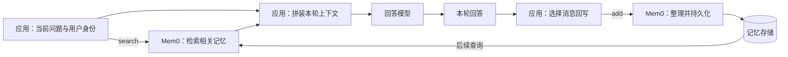

# Mem0

> 最后更新：2026-10-30
> 版本锚点：论文 `arXiv:2504.19413v1`；Python `v2.2.1`、TypeScript `ts-v3.3.1`，commit `94c3fe9f238f3dbf29c9ce98643bd71eb13077cd`
> 阅读基础：了解 LLM 应用的消息历史、上下文窗口和基本向量检索；本文中的 Platform 能力来自同一 commit 的公开文档快照。

Mem0 是应用与模型之间的跨会话记忆层：从交互中整理值得保留的信息，持久化为可检索的记忆，再由应用把相关记忆放回后续回答的上下文。它解决的是“下一次调用模型时，怎样找回此前知道的用户或任务信息”，而不是通过 `add()` 训练模型权重。

例如，用户上周说“我是素食者”，今天问晚餐建议。应用不必每次附上全部旧对话，可以检索出与饮食有关的记忆，再让回答模型据此生成建议。这里同时有三项工作：选择并保存信息、找到当前相关信息、把信息用于回答。Mem0 负责前两项，第三项仍需应用编排；抽取遗漏或检索遗漏，也不会因“有长期记忆”这个名称而自动消失。

## 一次交互怎样连起应用、记忆与模型

官方示例采用“检索 → 生成 → 回写”的编排。它不是 API 强制的唯一调用顺序，但能说明系统各方的责任：



1. 应用确定当前用户和任务范围，用问题调用 `search()`；记忆层按范围取回相关记录。
2. 应用取出返回项的 `memory` 文本，连同当前问题、必要的本轮历史与系统指令送入回答模型。
3. 回答模型生成响应。它使用的是此次输入的上下文，不是因为记忆已被写进模型参数。
4. 应用把选定的 user/assistant 消息交给 `add()`，供后续交互使用。普通抽取路径会调用 LLM 整理事实；它与生成本轮回答是两个不同职责，使用的模型也可以分别配置。

下面是与固定 Python OSS API 形状一致的编排示意。`memory` 是已配置好的 `Memory`，`generate_reply` 是应用自己的回答函数，不是 Mem0 API；此例未实际运行：

```python
def chat(message, user_id):
    hits = memory.search(
        message, filters={"user_id": user_id}, top_k=3
    )
    context = "\n".join(item["memory"] for item in hits["results"])
    reply = generate_reply(message=message, memory_context=context)
    memory.add(
        [
            {"role": "user", "content": message},
            {"role": "assistant", "content": reply},
        ],
        user_id=user_id,
    )
    return reply
```

这个闭环可以减少反复携带旧历史的需要，但也引入“抽取留下了什么、检索遗漏了什么、应用是否正确使用”的选择问题。相比直接使用全历史，它是选择性保存与选择性读取的设计，不意味着已证明在所有任务上更准确或更省成本。

Platform 写入还有异步边界：新增请求返回 `event_id` 和 `PENDING`，应用可查询事件直到 `SUCCEEDED` 或 `FAILED`。请求返回不代表抽取、状态处理与可检索已经完成，不能直接从上述 OSS 示意推得托管端立即写后读的保证。

## 保存的是什么，各组件怎样协作

消息是带角色和内容的交互输入；记忆记录是抽取或直接导入后保存的条目，常表达偏好、身份或事件等信息。两者不是一一对应：不能把“新增一条记忆”理解成“完整保存一轮原始对话”。搜索返回记录，不直接返回最终回答。

固定 Python OSS 的主要分工如下：

| 组件／数据 | 在读写中的作用 | 为什么需要区分 |
|---|---|---|
| LLM | 普通写入时从消息整理可保存信息；抽取指令可限定关注什么 | 指令约束抽取，不等于每条原话都会保存或模型一定服从 |
| embedding 模型与向量存储 | 将记忆和查询变成向量，以相似度找候选；记录另有文本、ID、时间和 metadata | 向量服务于寻找，`memory` 文本才是应用常用的上下文内容 |
| 实体索引 | 连接文本中出现的人名、项目名等实体与相关 memory IDs，供查询增强排序 | “提到同一实体”不同于“哪条事实替代哪条事实” |
| SQLite 变更 history | 记录 memory 的新增、修改等事件 | 它不是完整聊天记录 |
| SQLite messages 缓存 | 按 scope 保留最近 10 条处理后的消息，为后续普通抽取提供短上下文 | 它也不是无限长期的原始会话档案 |

普通抽取会把本次消息、同 scope 最近的短消息上下文，以及最多 10 条召回的旧记忆一起交给抽取 LLM。因此，短消息缓存用于理解新输入，变更 history 用于记录记忆操作，持久化 memory 则服务后续检索；三者虽都与过去有关，却不是同一份历史。

普通自动抽取不等同于所有写入：`infer=False` 可绕过 LLM 抽取，固定 OSS 按消息直接追加；Python 还保留 procedural memory 分支。图片等输入是进入抽取的另一种入口，依赖适用模型和配置，不代表输出一定是另一套多模态向量检索。

检索侧，语义相似度负责寻找候选，关键词分数补充词语匹配，实体关联补充“围绕谁／哪个项目”的线索。这些信号如何组合、后端是否支持，以及可选 reranker 如何参与，见[检索机制](./retrieval.md)。

## 记忆属于谁：用户、agent 与会话

这里有两种容易混淆的“实体”。`user_id/agent_id/run_id` 是调用方提供的作用域标识，用来限定记录归属和查询范围；实体索引中的人名、公司名、主题词则来自记忆文本，用来帮助相关性排序。文本提到 Alice 不等于记录归属于 `user_id="alice"`。

| 作用域 | 所表达的范围 | 对读取的影响 |
|---|---|---|
| `user_id` | 某个用户的长期信息 | 只按 user 查询，可跨该用户不同 run 找相关记忆 |
| `agent_id` | agent 身份或工作上下文 | 只按共享 agent 查询，不能据此区分使用它的两个用户 |
| `run_id` | 一次会话、工单或任务运行 | 增加 run 条件会缩小到该运行，不再自然覆盖此前其他 run |
| Platform 的 `app_id` | 某个应用范围 | 是托管接口的维度，不能直接当作固定 OSS 的同名顶层参数 |

固定 Python OSS 的 `add()` 至少需要 user、agent、run 中一个有效 ID；写入时提供的多个 ID 会一起保留到记录中。`search()` 要求 `filters` 顶层存在至少一个对应 ID 键，不能期待它自动知道“当前用户”。这层门禁不保证值有效：`None` 可通过检查，仅在嵌套条件中提供 ID 又不能满足顶层要求；应用应显式传入正确的 ID。默认 Qdrant 后端将平铺的多个条件作 AND；例如同时限定 user 与 run，只匹配两者都符合的记录。其他后端的操作符覆盖仍需按实现判断。

因此，两个用户共享一个 agent 时，可以先分别用各自 `user_id` 写入和检索；若某条记忆还带有 `run_id`，只按 user 读仍可匹配它，增加当前 run 则会排除其他 run。应用若希望跨会话记住用户，不应把“带上更多过滤条件”一律当成更正确。scope 是数据选择条件，应用仍需验证调用者身份并正确构造范围；它本身不是本研究已证明的权限保障。

Platform 的默认抽取另有公开契约：即使一轮调用同时传 user 与 agent，单条事实也按说话方分别归属，通常不会同时带这两个字段；app/run 则随记录保留。用 user AND agent 搜索会漏掉这样产生的记录，Direct Import 又是例外。因此不能把 OSS 的多 ID 继承规则或某个平台示例不加区分地搬到另一端。单独按 user 或按明确的 OR 范围读取，应结合真正想取的记忆判断。

## 三种形态分别怎样处理事实变化

论文、固定 OSS 与托管 Platform 是理解边界，不是三个可以互换的部署开关：

| 形态 | 写入与状态的核心机制 | 读取时应怎样理解 |
|---|---|---|
| 论文旧版 `arXiv:2504.19413v1` | extraction + update；先抽取，再由 LLM 对旧记忆选择 ADD / UPDATE / DELETE / NOOP；Mem0g 图方案可将过时关系标为 invalid | 描述论文设计，不直接代表固定 OSS 或服务端 |
| 固定 OSS Python `v2.2.1` / TS `ts-v3.3.1` | 普通自动抽取对 memory 记录 ADD-only，仍有 prompt 筛选、候选局部文本 hash 去重和实体索引维护；显式 update/delete 仍存在 | 检索以相关性排序和显式过期过滤为主，不自动裁决哪个矛盾值是当前事实 |
| Platform 文档快照 | Dream 在新增时处理 supersede / merge，并有后台 Synthesis；还有原生图、时间与访问历史相关能力 | 公开状态与排序契约成立，不等于已知内部实现或已经验证效果 |

例如用户从北京转到上海工作：论文有写入时变更旧事实的机制；固定 OSS 普通追加不因此自动删掉北京记录；Platform 可将旧项标为 `superseded`，但默认读取仍包含这种历史项，需用 `latest_only=true` 才按状态只取 active。判断“当前事实是什么”与判断“哪段文字更相关”是不同任务。

OSS 自 `v2.0.0` 起对应算法代次 v3，包版本 `2.x` 不能读成旧算法 v2。版本谱系、局部去重与事实替代的详细区别见[一致性模型](./consistency-model.md)。

## Platform 的特色能力分别补哪一层

以下是固定文档所描述的概念与可用范围；没有在此研究中运行服务端验证。

**Graph Memory 把分散记忆沿实体连接。** 多条记录分别提到同一位同事或项目，平台把实体与提及它的记忆连起来，查询实体匹配参与排序。它是当前原生的实体—记忆关系，不是论文旧图方案或 OSS entity index 的同义词，也不承诺有 `manages` 等带类型的关系边；API 不单独返回完整图 payload。

**Dream 包含两种时机不同的工作。** Supersede 处理新事实否定旧事实，Merge 处理重复或更丰富的信息，随新增记忆评估。旧记录保留：默认读取 active + superseded、隐藏 merged；`include_merged=true` 可纳入 merged。Synthesis 则定时从多条记忆形成新的模式记忆，例如从多次训练与作息记录概括长期运动习惯，并链接来源；原条目继续保留。它是项目 opt-in、Pro+、非实时，且只考虑开启后新增、仅带 `user_id` 的记忆，附带 agent/app/run 的记录不在其用户综合范围，另有至少 20 条和调度周期条件。

**Temporal Reasoning 处理事件时间与查询时间的匹配。** “上周在东京开会”和“去年在巴黎开会”可以都是真的，问题问“上周”时应提高前者的排序，而不是无条件取最新写入。Platform 可用 `timestamp` 保留导入对话的时间、用 `reference_date` 指定查询参考的“现在”。固定 OSS 不支持这项服务端能力。

**Memory Decay 处理使用历史。** Platform 项目开启后，会依据最近检索访问情况对分数作软调整，文档给出约 0.3–1.5 的乘数范围；默认关闭。它不是物理删除，也不等于事件时间判断。与之不同，`expiration_date` 是应用指定日期后的读取期硬隐藏，OSS 也有，且不是存储 TTL。软重排仍会改变 top-k 中哪些记录返回，不能理解成所有旧项都会保留在每次结果里。

这些能力各自解决连接、变化、综合、时间或使用频率的问题，不能压成一个“系统自动记住正确事实”的保证。抽取指令、直接导入、metadata filters 和可选 rerank 也会改变系统行为，分别位于写入控制、数据导入、范围选择和结果重排环节。Platform 另有 beta Profiles，按 JSON Schema 生成每用户结构化摘要，输出目标与 Dream 新增自由文本模式记忆不同。

## 能据此作什么判断

若需要自行控制模型、向量后端和实现，固定 OSS 提供可配置的抽取／存储／检索闭环；若希望使用上述托管状态与排序能力，则需按 Platform 契约评估。两端名称和接口相近，不能据此假定 scope、去重、图或时间机制相同。

本总览覆盖系统主干与主要能力关系；各特色能力的深层机制、生产部署、权限审计和性能调优仍未穷尽。真实持续交互中的抽取质量、写入污染、旧事实复活以及 Platform 状态判定质量仍需行为证据。公开 benchmark 不能单独回答这些问题，具体口径见[评测边界](./evaluation.md)；尚未裁决的评测争议见[冲突记录](./conflict.md)。

## Evidence

- **Status**：论文与官方能力契约为 `Verified`；固定 OSS 组件、数据、scope 与调用路径为 `Observed`；职责模型和设计后果为 `Inferred`。素食、工作城市及编排代码用于教学说明，未作为运行效果证据。
- **Sources**：`arXiv:2504.19413v1`；固定 `mem0ai/mem0@94c3fe9f…` 的 README、`memory/main.py`、`memory/storage.py`、Qdrant 及 Platform 能力文档。
- **Trace**：原有版本／一致性依据见 [`notes/evidence.md`](./notes/evidence.md) M1–M5、M16、M22–M23；新增整体与能力对应 M26–M31，精确路径和快照见 [`notes/source.md §5`](./notes/source.md#5-整体解释与检索补查2026-10-30)。
- **Needs**：Platform 内部实现与真实效果、OSS 端到端可靠性仍未闭合；`92.5/94.4` 的完整运行配置和同条件复现另见评测正文，不由总览补写成定论。
