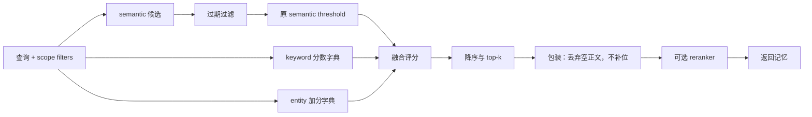

# Mem0 检索机制

> 最后更新：2026-10-30
> 版本锚点：固定 Python `v2.2.1`、TypeScript `ts-v3.3.1`，commit `94c3fe9f238f3dbf29c9ce98643bd71eb13077cd`

一次记忆查询既要找“意思相近”的事实，也可能需要准确的名字、术语或实体线索。固定 OSS 将这些信号组合起来，但它们承担不同责任：semantic 决定谁有机会参赛，关键词和实体主要改变已入选记录的得分。理解这层区别，才能解释为什么很强的关键词命中仍可能不返回。

本文以固定 Python 同步 `Memory.search()` 为主，说明默认未启用额外 reranker 时的候选与排序，再单独说明重排扩展。公开数量参数叫 `top_k`，源码内部称 `limit`；以下以 `k` 表示这个数量。TypeScript 与各后端只在已经核对的差异处并列，不将所有路径合成一种实现。

## 三种信号分别在找什么

| 信号 | 对读者而言的含义 | 固定实现如何使用 |
|---|---|---|
| semantic | 查询和记忆的向量相似度，可连接措辞不同但意义接近的文本 | 决定候选集合，参与 threshold 门控和融合 |
| keyword / BM25 | 词语匹配的相关性；BM25 通常综合词频、词的区分度与文本长度，适合补充具体术语线索 | 后端提供关键词结果，正分数经归一化后按 memory ID 参加融合 |
| entity boost | 查询提到的人、组织、项目等实体，是否关联到某条记忆 | 查实体索引取得关联 IDs，对相应 memory 提供加分 |

“找与 Apollo 项目有关的记忆”可以借助向量含义、Apollo 这个词、以及关联 Apollo 的实体索引。三者都是相关性线索，不是同一事实的新旧版本判定。这里的 entity 也不是用于权限或范围选择的 `user_id`，作用域的区别见[总览](./overview.md)。

关键词分数没有被直接当作 semantic 分数相加。固定实现对正的 raw keyword score `r` 使用 sigmoid：

$$
b(r)=\frac{1}{1+\exp(-a(r-m))}
$$

`m` 是映射到 0.5 的原分数，`a` 控制曲线陡度；二者按词形还原后查询的 term 数选择，例如不超过 3 个 term 时为 `m=5.0, a=0.7`。这在数值上压缩关键词分数，不能据此认为不同后端已具有同一种相关性概率。关键词后端也不一定真正实现 BM25。

实体信号则从查询抽取实体、embedding 后匹配 entity store，沿索引找到相关 memory IDs。匹配相似度低于 0.5 时跳过；一次匹配对关联记忆的加分为：

$$
e=\frac{0.5s}{1+0.001(n-1)^2}
$$

`s` 是实体匹配相似度，`n` 是该索引项关联的记忆数。同一 memory 被多个实体命中时取最大加分，不逐个累加。由公式可看出，关联非常多记录的泛化实体会被折减，这是从实现推出的效果，不是已确认的作者动机。可选实体抽取依赖不可用时可以没有实体信号。

## 从查询到返回：资格先于融合

以 `memory.search(query, filters={"user_id": "u1"}, top_k=5)` 为例，固定同步路径依次进行：

1. **确定范围并预处理查询。** search 规范化 filters 顶层 IDs 并检查 ID 键是否存在，校验边界见总览的作用域解释；生成关键词用的词形还原文本和实体，embedding 原查询用于向量搜索。
2. **取语义候选。** 向量后端请求 `max(4k, 60)` 条，这里是 60。请求扩大是为了给后续重排留空间，不保证一定有 60 条合法结果。
3. **取得补充分数。** keyword 搜索也请求同样数量；实体匹配产生 memory-ID 到 boost 的映射。这两份映射可能包含 semantic 池外的 IDs。
4. **构造实际候选并隐藏过期项。** 只遍历 semantic results，默认排除 payload 已过期的记录。关键词或实体映射没有权力自行添加一个候选。
5. **执行原始 semantic threshold。** 低于门槛的候选在融合前丢弃，关键词与实体加分都不能补救。
6. **融合、排序、截取。** 计算通过者的融合分数，降序取最多 k 条，再包装成带 `memory`、`score`、ID 等字段的结果。包装时还会丢弃 payload 的 `data` 为空的项，不从首轮 top-k 外补位；异常记录因此也可能使结果不足 k 条。

语义和关键词搜索收到完整 filters；实体索引查询仅从中抽取平铺的非空 user/agent/run 标识，未复制任意 metadata 条件。因此不能将“三种信号”解释成三个完全相同范围的独立召回器。最终记录资格来自受过滤的 semantic 候选，信号字典仍可能受其他 IDs 的条目影响。

### 融合公式与分数尺度

设候选的 semantic、归一化关键词和实体贡献分别为 `s/b/e`，则：

$$
\mathrm{score}=\min\left(\frac{s+b+e}{D},1.0\right),\qquad
D=1+\mathbf{1}[\text{bm25 字典非空}]+0.5\mathbf{1}[\text{entity 字典非空}]
$$

两种补充字典都空时 `D=1`，仅关键词非空时为 2，仅实体非空时为 1.5，两者都有为 2.5。缺少当前候选的字典项时，该项贡献为 0；**分母看整份字典是否非空，不看当前候选有没有获得加分。**

例如某候选只有 semantic=0.9。两字典都空时得分 0.9；两字典非空但仅含其他 IDs 时，它的贡献仍为零，却得到 `0.9/2.5=0.36`。这意味着跨调用比较公开 score 时，要注意信号是否启用和是否有命中，不能把它当成固定标尺的“事实正确概率”。

threshold 针对融合前 semantic，不是对最终 score 再过滤。若原 semantic 已过门槛，融合后分数低于该数值仍可返回。`explain=True` 可在最终返回项中增加分项、分母等 `score_details`，解释它怎样得到融合分数。未返回项没有淘汰原因明细；区分“没入池”“被过滤或门控”和“融合后排低”，还需检查中间候选与处理结果。

### 一个完整的构造例子

查询关于 Apollo 项目的信息，设 `top_k=2`、threshold=0.6，以下都是合法且未过期记录的**构造评分输入**；关键词列已经归一化，并非 raw BM25：

| 记录 | semantic | keyword | entity | 所在阶段与结果 |
|---|---:|---:|---:|---|
| P：项目交付信息 | 0.75 | 0.50 | 0.25 | 通过门控，`1.50/2.5=0.60` |
| Q：语义很近的项目概述 | 0.85 | 0.05 | 0 | 通过门控，`0.90/2.5=0.36` |
| R：含准确项目词的较远记录 | 0.55 | 0.90 | 0.50 | 未过 0.6，不能进入融合 |
| S：关键词命中但未被语义取回 | 未入池 | 很高 | 很高 | 没有候选资格 |

默认不加额外 reranker 时返回 P、Q。P 原本 semantic 低于 Q，却借补充信号排到前面；R 即使假想融合可得 0.78，也已被前面的门控排除；S 则更早就没有入场机会。Q 的最终 0.36 低于 threshold，不影响它已经通过的 semantic 资格。

如果 P 的 `expiration_date` 早于查询时的 UTC 日期，且保持默认 `show_expired=False`，它会先被隐藏；日期等于 UTC 当天时仍可见。R、S 不会因为空出了名额就被重新纳入，所以结果可能少于 k 条。若只改变 `created_at/updated_at`、候选与过期状态都不变，评分函数不会据此改变上述分数和顺序。

## 后端与额外重排会改变什么

“同一个 SDK 版本”不代表三种信号都实际可用：

- Python 基类 `keyword_search()` 默认返回 `None`；未覆盖的后端初始化时告警并关闭 BM25，仍可进行 semantic 搜索，实体增强是另一项条件。
- Qdrant 需 `bm25` sparse slot 与 fastembed 等条件。旧 collection 缺 slot 时关闭 BM25，不等于整个语义搜索故障。
- 有方法也不代表是相同 BM25：Pinecone 需启用 hybrid，pgvector 使用 PostgreSQL 全文检索，固定 Vertex 覆盖方法仍返回 `None`。
- TypeScript 的 `keywordSearch` 是可选方法，缺失、返回 `null` 或抛错会静默降级，不能照搬 Python 的告警预期。

排查关键词无效时，应先确认后端与 collection 条件，再看是否真的形成分数字典，以及命中的 ID 是否在 semantic 池内、是否通过 threshold。仅知道关闭了一个信号，不能计算真实质量下降多少；那还取决于查询、相关记忆和对照结果。

可选 reranker 位于**首轮融合已经排序、截取 k 条并完成包装之后**，只能重新处理此时保留的至多 k 条。配置了 provider 且 `rerank=True` 才调用，外层失败时回退原结果；标准实现可增加 `rerank_score`。启用后顺序可能不再严格按原 hybrid score，但它看不到池外记录、门控淘汰项和首轮 top-k 以外的记录，不能把它当作补召回的一轮新搜索。

## 可以推导哪些取舍

以下是根据固定机制与替代方案作的分析，不是运行实验或作者决策说明。

| 替代方案 | 相对当前流程可能改变什么 | 需要承担的代价或新判断 |
|---|---|---|
| semantic-only | 不再有补充分数改变池内排序，分数尺度也不同 | 名称、术语和实体线索可能失去作用；质量差异需对照 |
| semantic 与 keyword 候选取并集 | S 这类池外关键词项可获得评分机会 | 需定义新增候选的 semantic 分数、去重、过滤和预算；不是只改一个加法 |
| threshold 移到融合之后 | R 可能获补充信号帮助通过，但 Q 可能因融合 score 较低被淘汰 | 同一个数值的 threshold 已换了含义，需要重新理解或校准 |
| 给 reranker 更大候选池 | 重排器可能从当前首轮 top-k 之外选出结果 | 需改变调用位置或输入数量，不能从现有 `rerank=True` 推出已如此执行 |

把并集与后置门控组合起来，可以同时改变候选资格和淘汰标准。仅凭“更 hybrid”不能推出 recall、精度或成本必然改善；候选机会变多也可能挤掉此前有用的结果。

此层仍主要回答“在这些候选中什么更相关”。固定评分函数不读取创建/更新时间，也不裁决新旧事实矛盾；过期隐藏依赖调用方提供的 `expiration_date`，不是自动判别过时事实。Platform 的 Temporal、Decay、Dream 另有契约，不能把本页 OSS 公式当作它们的执行方式。写入期处理与事实状态的关系见[一致性模型](./consistency-model.md)，效果证明的要求见[评测边界](./evaluation.md)。

## Evidence

- **Status**：固定路径、信号生成、公式、顺序和 reranker 输入范围为 `Observed`；设计后果与替代方案分析为 `Inferred`。构造例子是源码语义的教学推演，非检索效果测量。
- **Sources**：固定 commit `94c3fe9f…` 的 `mem0/memory/main.py`、`mem0/utils/scoring.py`、`mem0/vector_stores/*`；`mem0-ts/src/oss/src/memory/index.ts`、`.../utils/scoring.ts`、`.../vector_stores/*`。
- **Trace**：Claim 级来源与状态见 [`notes/evidence.md`](./notes/evidence.md) M4–M4b、M23、M28；源码摘录、后端覆盖和信号补查见 [`notes/source.md`](./notes/source.md) §1.3–§1.3.3、§5.2–§5.3。
- **Needs**：真实样本下 semantic threshold 与各信号权重的端到端效果、以及同一实体多个矛盾值的实际返回行为仍未验证。
