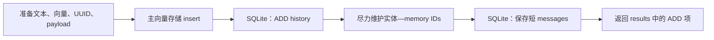

# Mem0 普通写入：消息怎样成为记忆

> 最后更新：2026-11-02
> 适用范围：Python OSS `v2.2.1`，`mem0ai/mem0@94c3fe9f238f3dbf29c9ce98643bd71eb13077cd`；主要解释普通 `infer=True`，另对照 `infer=False`。
> 阅读基础：了解消息角色、embedding 和向量检索。本文是固定源码的静态解释；例子未运行，不代表实际模型输出。

`add()` 接收消息，但不会把每条消息原样变成一条长期记忆。普通路径先给抽取模型一段上下文，再把模型输出整理成新增记录；主记录、变更账本、实体索引和短消息缓存依次写入，各有失败边界。因而“调用返回空”“返回 ADD”和“调用抛错”分别都需要进一步解释。

## 从一轮混合对话看输入与归属

假设应用传入以下内容：

```python
memory.add(
    [
        {"role": "user", "content": "我是素食者，今晚想吃面。"},
        {"role": "assistant", "content": "可以试试番茄蘑菇面。"},
    ],
    user_id="alice",
    agent_id="dinner-helper",
    run_id="dinner-1",
)
```

这里至少存在三种不同信息：用户长期饮食偏好、今晚的临时意图、助手提出的建议。抽取提示要求筛选值得记住的内容并区分归因，但并不保证模型一定按这三个类别输出。尤其不能因为助手推荐过蘑菇面，就认定用户喜欢蘑菇面。

调用方提供的 scope 与模型给出的归因是两回事。固定 OSS 规范化显式 `user_id/agent_id/run_id`，要求至少一个有效 ID，并把所有提供的 ID 一起放进记录 metadata 和旧记忆召回 filters；不会按说话方把 user 与 agent 拆成两套归属。传入 metadata 会深复制，身份键由显式参数控制。scope 仍是应用选择数据范围的条件，不能替代调用者授权。

字符串会先转为 user 消息，单个字典会包成列表。普通入口在进入抽取或直接写入前还会处理 vision 输入；普通文本消息保留原字典，部分多模态转换分支会重建为 `role/content`，因此不能假定所有输入的 `name` 都一直保留。非空 `timestamp` 在该 OSS 入口被拒绝，不能把 Platform 的历史事件时间参数照搬过来。

## 抽取模型实际看到什么

同一次写入使用两种历史，它们的选取方式不同：

| 上下文 | 如何取得 | 改变 run 会怎样 |
|---|---|---|
| 短消息缓存 | 按本次全部有效 scope IDs 的精确组合生成 session key，读取最近 10 条处理后消息 | user 相同但 run 不同，缓存组合不同 |
| 旧记忆候选 | 对本轮消息文本做 search embedding，直接向 vector store 取 `top_k=10`，filters 带全部有效 IDs | 带 run 会限制旧候选；只带 user 才可能跨其不同 run 召回 |

这里直接调用后端的向量搜索，并未经过公开 `search()` 的完整关键词／实体融合与 reranker 流程。因此不能拿[检索机制](./retrieval.md)中的完整读路径解释这十条候选，也不能假定它完成了公开读路径的过期过滤。

本轮消息被渲染为带 system/user/assistant 角色的文本，其他角色不进入这个渲染。抽取上下文还包含旧消息、旧记忆、UTC 日期、自定义指令，以及在这条路径中为空的 Summary 和 Recently Extracted Memories。旧消息每条 content 只取前 300 个源字符，超出后另加省略号；提示要求旧消息仅用于消解指代，新增事实来自 New Messages。缓存不是持续递归更新的完整会话摘要。

模型使用 additive extraction 提示，普通抽取做一次 LLM 调用并请求 JSON object。调用级非空 `prompt` 优先于配置的 `custom_instructions`，选出的自定义内容追加到抽取提示中；仅有 agent、没有 user 时另加 agent 上下文说明。这些都属于模型指令，尚未证明抽取准确率、去重质量或对指令冲突的实际处理。

如果模型输出“用户是素食者”，它还可以给出 `attributed_to`。实现会直接复制 truthy 的归因值，没有值域校验；它不会由此改变记录的 user/agent/run。普通抽取也不会自动从消息角色生成 `actor_id/role`。模型还可能输出 ID、event 或 `linked_memory_ids`，但这条路径不会用它们决定更新、删除或建立事实替代链；最终 memory ID 由实现新生成。

## 从 JSON 到可写入记录

解析器去除代码块后读 JSON 的 `memory` 字段，消费的形状类似：

```json
{"memory": [{"text": "用户是素食者", "attributed_to": "user"}]}
```

这是格式说明，不是该例真实运行结果。固定自定义指令文档中的 `facts` 示例与之冲突：合法 JSON `{"facts":["用户是素食者"]}` 不会被当作这条记忆消费，而会得到空抽取。JSON 解码失败时会尝试提取 JSON 再解析，解析层异常最后可降为空列表；但这里没有完整 schema 校验，例如非空 `{"memory":["用户是素食者"]}` 会在后续 `.get()` 处失败。格式冲突的事实与模型实际会输出什么必须分开，详见[冲突记录](./conflict.md#5-固定自定义指令示例与抽取解析格式不一致)。

随后先对所有非空 `text` 批量 embedding，再做 hash 去重。批量 embedding 抛错会逐条重试，逐条失败的文本会被跳过。因此“重复会被去掉”不意味着重复文本完全不花 embedding 成本。

代码去重比较原始抽取文本的 MD5，只检查前面召回的最多十条旧记忆及本批已见 hash。它既不是全库唯一约束，也不是语义等价判定：候选之外的相同文本可能再次新增；“不吃肉”和“我是素食者”也不会仅凭这层 hash 相互合并。prompt 的语义筛选与代码的精确去重承担不同责任。

通过准备阶段后，每条记录有新 UUID、抽取文本 `data`、供关键词检索使用的词形归一文本、hash、scope 和 metadata。`created_at` 沿用 metadata 已有值或取当前 UTC 时间，`updated_at` 初始等于它；truthy `attributed_to` 另写入 payload。这里准备好记录还不等于持久化成功。

## 四种存储怎样依次变化

正常主线如下。图中的各箭头表示调用顺序，不表示跨存储事务：



主存储先尝试批量 insert；抛错后用同一组预生成 ID 逐条重试。调用未抛错的项进入 `persisted_records`，后续 history、实体维护和返回值只处理这个子集。这里的“persisted”是实现按调用结果作出的判断，没有逐条读回确认；批量操作若已经产生副作用后才抛错，重试效果还取决于后端的 upsert／重复 ID 语义。

history 是独立的变更账本。批量写 history 失败会逐条重试，单条仍失败则记日志继续，不从 ADD 返回列表移除对应项。这与[直接 update](./direct-update.md)的 history 异常传播不同。普通 ADD history 也不是完整 payload 快照，不能由主记录含 role 或归因就推定账本保存了这些全部信息。

实体维护把持久化子集中的实体名称连接到 memory IDs，合并已有关联，供后续检索增强排序。固定批处理先查精确实体，仍对全部有效实体执行批量向量查询，再优先采用精确匹配，否则采用达到 `0.95` 阈值的向量匹配。因此即使已有精确实体，批量向量查询异常也可能阻断本轮实体维护。实体创建或更新不是 memory 内容 UPDATE。相关异常会被记录并吞掉，因此 ADD 成功不保证实体增强索引完整，也不证明实体含义识别正确。

最后，messages 在自己的 SQLite 事务里保存并裁到最近十条，才构造 ADD 返回项。它保留的是处理后消息，不是无限的原始对话档案。主向量存储、history、实体和 messages 没有一个共同的提交或回滚边界。

## 空返回与报错分别意味着什么

在下面所有“返回空”的分支中，仍要先成功保存 messages；保存失败就会向外抛错。

| 条件 | 普通写入的处理 | 能作的判断 |
|---|---|---|
| 模型返回空 memory，缺少 memory 字段，或解析异常被降为空列表 | 保存 messages，返回空 results | 不能仅据此断定输入没有值得记住的事实 |
| 抽取有项，但没有非空 text、embedding 均失败或全部被 hash 去重 | 没有待插入记录，保存 messages 后返回空 | 既可能是重复，也可能是准备阶段失败 |
| 非空 memory 的项形状错误，在后续 `.get()` 失败 | 异常传播，该位置尚未保存本轮 messages | 解析层容错没有覆盖完整结构 |
| LLM provider 调用失败 | 包装为 LLMError 向外传播，不保存本轮 messages | 未进入本轮主记录插入 |
| 有待写记录，批量及逐条主 insert 调用全部失败 | 先保存 messages，再抛 VectorStoreError | 不是正常的“无新增”；保存 messages 若失败可遮蔽原异常 |
| 主 insert 逐条重试部分未抛错 | 继续处理成功子集，通常仅返回该子集的 ADD | 返回值不提供逐项失败报告 |
| 主记录已写，history 或实体维护失败 | 尽力处理后继续 | 返回 ADD 不保证每层均完整 |
| 最后 messages 保存失败 | 回滚该次 messages 事务并向外抛错 | 主记录、history、实体可能已经改变 |

因此，调用抛错后盲目重试整个 `add()` 并不等价于重试一个尚未提交的事务：下一次会重新抽取、生成新 ID，而且 hash 只做候选局部去重。反过来，返回 ADD 也不保证该项必进未来任意查询的 top-k；读取还受范围、过期、候选和排序影响。真实后端故障、并发写入和可见性仍需单独观测。

这条路径还说明了删除后的一个条件性边界：单条删除或 scope 删除不清 messages。后续相同 scope 的 `add()` 仍可能把旧消息当作指代上下文；提示要求只从新消息抽取，所以既不能宣称旧事实必然复活，也不能仅凭主记录删除保证后续抽取完全不受旧上下文影响。清理范围见[删除生命周期](./deletion-lifecycle.md)。

## `infer=False` 改变了哪些责任

如果应用已经整理好要保存的文本，可以选择 `infer=False`。公共入口的 vision 预处理仍在它之前，因此它绕过的是普通事实抽取，不承诺整次调用绝不会使用任何 LLM。

| 机制 | 普通 `infer=True` | 固定 OSS `infer=False` |
|---|---|---|
| 输入如何成为记录 | 抽取模型从消息整理 text | 跳过 system／无效项，其余逐条直接写入内容 |
| 旧记忆与 hash 去重 | 召回候选，并做局部 hash 去重 | 不召回、不检查重复；虽写 hash，重复内容仍可新增 ID |
| embedding 与主存储 | 批量优先，失败可逐条 fallback | 逐条 embedding、insert |
| history／实体／messages | history 尽力、实体尽力、最后保存 messages | `_create_memory` 写主记录再写 history；不走普通实体维护和 messages 保存 |
| 中途失败 | 可只返回主 insert 未抛错的子集 | embedding、insert 或 history 异常传播，已写项不回滚 |

直接路径会写消息 role，普通文本携带 truthy `name` 时可写 actor_id；部分多模态转换可能去掉 name。history 报错时当前主记录也可能已经写入。这条路径既不是普通自动抽取的简写，也不能继承 Platform Direct Import 的同 scope 精确去重契约。

固定 `AsyncMemory` 在上述主要阶段、fallback 和失败边界上相对应，使用 `to_thread` 包装多处阻塞操作；“async”不代表四层并行提交，也不能据取消协程推定工作线程已停止或已写数据被回滚。procedural memory、TypeScript 和 Platform 服务端不在本专题的普通路径结论内。

## Evidence

- **Status**：固定源码中的输入、上下文、解析、持久化顺序和异常分支为 `Observed`；重试风险、空返回的不可辨识性和缓存影响为条件性 `Inferred`。实际抽取、污染率、故障残留与并发效果为 `Unverified`。
- **Sources**：固定 [main.py](https://github.com/mem0ai/mem0/blob/94c3fe9f238f3dbf29c9ce98643bd71eb13077cd/mem0/memory/main.py#L760)（入口；普通写入 L881–1220；async L2564–2901；`_create_memory` L1975 起）；[storage.py](https://github.com/mem0ai/mem0/blob/94c3fe9f238f3dbf29c9ce98643bd71eb13077cd/mem0/memory/storage.py#L150)；[prompts.py](https://github.com/mem0ai/mem0/blob/94c3fe9f238f3dbf29c9ce98643bd71eb13077cd/mem0/configs/prompts.py#L468)；[utils.py](https://github.com/mem0ai/mem0/blob/94c3fe9f238f3dbf29c9ce98643bd71eb13077cd/mem0/memory/utils.py#L61)。
- **Trace**：延续 M2／M2a–M2c、M3d 的入口观察；新增对照见 [`notes/evidence.md`](./notes/evidence.md) M41–M45，核验定位见 [`notes/source.md §6`](./notes/source.md#6-普通写入机制补查2026-11-02)。
- **Needs**：未运行模型、真实 API、故障注入或 benchmark；未证明全部后端实现一致，也未完成 Mem0 对象整体深入研究。实体匹配效果、抽取归因质量和实际成本收益不能由静态流程推出。
